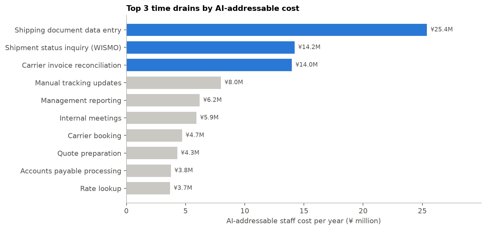

# AI Operations Audit: Top 3 Time Drains at a Japanese 3PL

**Case study.** A mid-sized third-party logistics provider in the Kanto region of Japan (~60 office staff) wants to know *where its team's time actually goes, which three operational time drains to fix first with AI, and what that is worth*. This project answers that end to end: data cleaning, time-drain analysis, AI opportunity scoring, ROI, an NLP proof of concept, an interactive dashboard and a client-ready audit report.

> Built on realistic synthetic data (12 months, ~166k time-tracking entries, 26k customer emails, 41k shipping documents, 34k carrier invoice lines). No real company data is used.

**Live dashboard:** [https://jp-3pl-ai-audit.streamlit.app/] · **Report:** [`reports/AI_Operations_Audit_Report.pdf`](reports/AI_Operations_Audit_Report.pdf)

## Key results

| | |
|---|---|
| Hours logged by office staff in 12 months | **104,555 h** (¥355.9M loaded cost) |
| Share of hours spent on the top 3 drains | **25%** (vs 14% in meetings) |
| Capacity the 3 initiatives free up | **17,287 h/yr ≈ 9.9 FTE** |
| Net annual benefit after running costs | **¥51.0M** |
| One-off investment / blended payback | **¥14.0M / 3.3 months** (7.9 months at half the planned automation) |

**The top 3 time drains**, ranked by the staff cost AI can realistically remove:

1. **Shipping document data entry** (Operations): 41,000 documents re-typed a year, 24% with keying errors → intelligent document processing with human validation
2. **Shipment status inquiries / WISMO** (Customer Service): 46% of tickets, 22% reopened → proactive tracking notifications + LLM reply assistant
3. **Carrier invoice reconciliation** (Finance): every line checked by hand, ¥20.5M overbilled, 38% never recovered → automated rate-card matching

**Two findings a client would not get from a survey alone:**

- Meetings are the largest block of time but only a small AI opportunity; ranking by *AI-addressable cost* changes the priority list.
- Staff over-weight visible, frustrating work (meetings, Excel reports) and under-weight the high-volume micro-tasks that actually consume the hours.



## Approach

1. **Measure** – clean time-tracking data and cost every hour with loaded hourly rates
2. **Compare** – survey perception vs logged hours
3. **Score** – AI-addressable share per task (documented assumptions) → AI-addressable cost → top 3
4. **Deep-dive** – validate each drain with operational data (tickets, documents, invoices)
5. **Size** – ROI, payback, sensitivity (50/75/100% of planned automation)
6. **Prove** – NLP email classifier as a proof of concept for the WISMO initiative
7. **Plan** – phased roadmap with success measures

## Email classifier proof of concept

TF-IDF (word + character n-grams) + logistic regression trained on the inbox history.

| Model | Accuracy | Macro-F1 |
|---|---|---|
| Keyword rules (baseline) | 89.5% | 0.87 |
| TF-IDF + logistic regression | **97.4%** | **0.97** |

With a 0.90 confidence threshold, ~80% of WISMO emails can be auto-handled at ~97% precision, while most mixed-topic emails are routed to an agent. Precision is capped by the ~3% of historic agent labels that are wrong.

## Repository structure

```
├── app.py                         # Streamlit dashboard (5 tabs incl. ROI simulator and live classifier)
├── requirements.txt
├── data/
│   ├── raw/                       # synthetic source exports (time logs, tickets, documents, invoices, survey)
│   ├── app/                       # small aggregated tables used by the dashboard
│   └── README.md                  # data dictionary
├── notebooks/
│   ├── 01_data_cleaning.ipynb
│   ├── 02_time_drain_analysis.ipynb
│   └── 03_email_classifier_poc.ipynb
├── reports/
│   ├── AI_Operations_Audit_Report.pdf
│   └── figures/
└── src/
    ├── generate_data.py           # reproducible synthetic data (fixed seed)
    └── build_report.py            # builds the PDF report from analysis outputs
```

## Run it

```bash
pip install -r requirements.txt
python src/generate_data.py        # optional: data/raw is already included
# run notebooks 01 -> 02 -> 03 (01 recreates data/processed/)
python src/build_report.py
streamlit run app.py
```

## Tools

Python · pandas · scikit-learn (NLP) · matplotlib · Plotly · Streamlit · ReportLab
